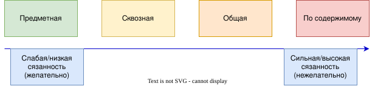
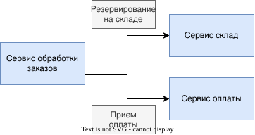
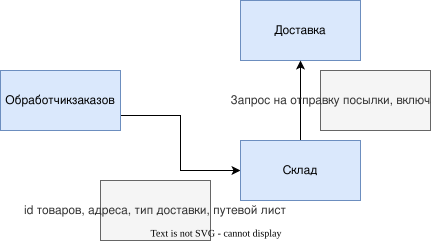
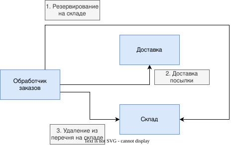
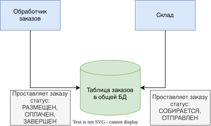
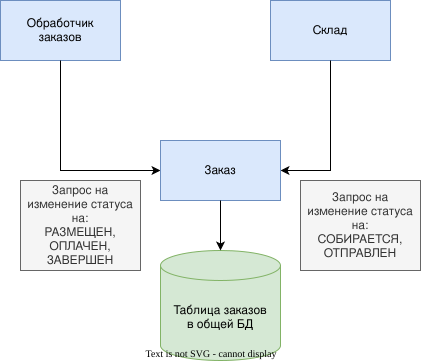

## Связность (Cohesion)
**Определение:** Мера силы взаимосвяжанности элеменов сервиса; способ и степень, в которой задачи, выполняемые им, связаны друг с другом. Код, в который вносят изменения как в единое целое, остается единым целым.\
Требуется функциональность, сгруппированная таким образом, чтобы иметь возможность вносить изменения в как можно меньшем количестве мест.\
Если соответствующая функциональность распределена по всей системе, мы говорим, что связность слабая, тогда как в микросервисах стремимся к сильной связности.

*Создание микросервисов. 2-е издание. Сэм Ньюмен., стр. 64*

## Связанность (Coupling)
**Определение:** представляет собой степень взаимосвязи между сервисами. При создании систем необходимо стремиться к максимальной независимости сервисов, то есть их связанность должна быть минимальна.\
Изменения, вносимые в один сервис не требуют изменений в другом.\
Слабо связанный сервис имеет необходимый минимум сведений о сервисах, с которыми ему приходится сотрудничать. Это означает, что нам следует ограничить количество различных типов вызовов от одного сервиса к другому, потому что помимо потенциальной проблемы с производительностью интенсивное общение может привести к сильной связанности.

*Создание микросервисов. 2-е издание. Сэм Ньюмен., стр. 64*

## Cohesion и Coupling
Структура стабильна, если если связность сильная, а связанность слабая.\
Связанность в системе будет неизбежно, но нужно ее уменьшить

*Создание микросервисов. 2-е издание. Сэм Ньюмен., стр. 65*

## Типы связанности

*Создание микросервисов. 2-е издание. Сэм Ньюмен., стр. 66*

### Предматная (доменная) связанность
Описывает ситуацию, в которой одному микросервису необходимо взаимодействовать с другими, посколько первому требуется использовать функциональность, предоставляемую вторым микросервисом.

Сервис обработки заказов в этой операции зависит от микросервисов Сервис склад и Сервис оплаты и связан с ними.\
Между самими сервисами Сервис склад и Сервис оплаты такой связи нет, они не взаимодействуют.\
Эта связь считается слабой, но и тут можно столкнуться со сложностями (слишком много логики централизована в одном сервисе или передача раздувающихся объемов данных).\
При построении такой связи не забываем о сокрытии информации.

*Создание микросервисов. 2-е издание. Сэм Ньюмен., стр. 67-68*

### Сквозная связанность
Описывает ситуацию, в которой один микросервис передает данные другому микросервису исключительно потому, что данные нужны какому-то третьему микросервису, находящемуся дальше по потоку.\
Во многих отношения, это одна из самых проблемных форм связи, поскольку она подразумевает, что вызывающий сервис должен знать, что вызываемый им сервис вызывает еще один.\
Ему надо знать, как работает удаленный от него микросервис.\
Основная проблема в том, что изменения требуемых данных ниже по потоку может привести к более значительному изменения выше по потоку.

#### Вариант исправления №1
Рассмотреть, имеет ли смысл для вызывающего микросервиса просто обходить посредника.\
Иногда помогает.

Но тут мы добавляем сложности и логику в Обработчик заказов, которая ранее была внутри Склада (запросы на резервирование и удаление)

#### Вариант исправления №2
А что если полностью скрыть Путевой лист от сервиса Обработчик заказов.\
То есть, делегировать управление запасами и организацию отправки посылки сервису Склад.\
Сделаем, чтобы Склад получал необходимую информацию в рамках своего контракта и сам создавал Путеовй лист

В этом случае необходимость модификации всех трех микросервисов не исчезла, но нам предоставлено гораздо больше возможностей в отношении того, когда и как эти изменения вносить.\
Если бы у нас была сильная (сквозная) связанность из начального примера, добавление нового документа (к примеру, Таможенная декларация) могло бы потребовать поэтапного развертывания всех трех микросервисов

#### Вариант исправления №3
Все еще слать путевой лист в Склад из Обработчика заказов, чтобы тот передавал его в Доставку.\
Однако сейчас путвой лист никак не обрабатывается Складом, а просто принимается, как некое неструктурированное поле и передается дальше наравне с данными, которые готовит сам склад для Доставки.\
Так при изменении Путевого листа, все еще придется внести правки в Доставку и Обработчик заказов, но в Склад вносить хи не придется, потому что он не интересуется фактическим содержимым путевого листа.

*Создание микросервисов. 2-е издание. Сэм Ньюмен., стр. 69-72*

### Общая связанность
Возникает, когда два или более микросервисов используют общий набор данных.\
Как пример, несколько микросервисов, использующих общую базе данных. Еще может быть общая файловая система и память.\
Иногда это допустимо, но чаще - нет.\
**Прблема** состоит в том, что изменения в структуре данных могут повлиять на несколько микросервисов одновременно.\
Еще, множесто микросервисов, которые используют одну и ту же БД, файловую систему или другой общий ресурс могут его перегружать, приводя к замедлению или недоступности

Для примера, 2 микросервиса пишут в одну и ту же таблицу статус обработки чего то (Заказа, например).

Чтобы защититься от конфликтов, можно было бы использовать конечный автомат - когда задаются правила перехода из статуса в статус, запрещая неправильный переход (как статусы тикета в Jira), но оба микросервиса должны его реализовать, то есть разделять ответственность.

#### Решение №1
Можно было бы выделить одтельный микросервис для управления заказом.\
При этом, нижестоящий микросервис (Заказ) сможет отклонять некорректные запросы.\
При этом, если микросервис становится тонкой CRUD-оболочкой над БД - это признак слабой связности и более сильной связанности, так как логика, которая управления данными распределена по другим местам системы.\
Лучше реализовать сервис, как нечто большее, ем просто CRUD над БД.

*Создание микросервисов. 2-е издание. Сэм Ньюмен., стр. 72-75*

### Связанность по содержимому
Связанность по содержимому появляется, когда вышестоящий сервис проникает во внутренние компоненты нижестоящего и изменяет его состояние.\
К примеру, обращение внешнего сервиса к БД другого микросервиса и изменение напрямую.\
Тогда сокрытие информации выходит из-под контроля, не могут быть внесены изменения без лишнего труда.\
Этого надо избегать

*Создание микросервисов. 2-е издание. Сэм Ньюмен., стр. 76-77*