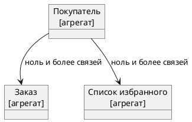

## Единый язык
Идея использования языка говорит, что мы должны стремиться употреблять в нашем коде те же термины, что и пользователи.\
Наличие общего языка между командой доставки и реальными людьми облегчит моделирование домена и улучшает коммуникацию.\
Благодаря внедрению. разработчик, взявший в руки story, написанную  с использованием терминов, с высокой вероятностью поймет их значение.

*Создание микросервисов. 2-е издание. Сэм Ньюмен., стр. 78-79*

## Агрегат
Нечто, имеющее состояние, идентичность, жизненный цикл, которыми можно управлять как частью системы.\
Можно рассматривать агрегат, как понятие из реальной предметной области - заказ, инвойс, единица хранения.\
Жизненный цикл агрегата обычно связан с этими понятиями.

*Создание микросервисов. 2-е издание. Сэм Ньюмен., стр. 79*

### Невалидные состояния агрегата
Если внешняя сторона запрашивает переход состояния в агрегате, тот в свою очередь может сказать **нет**.\
В идеале необходимо реализовать алгоритм таким образом, чтобы недопустимые переходы состояний были невозможны.

*Создание микросервисов. 2-е издание. Сэм Ньюмен., стр. 80*

### Взаимодействия агрегатов
Одни агрегаты могут взаимодействовать с другими.\
К примеру, агрегат `Покупатель` связан с одним или несколькими агрегатами `Заказ` и `Список избранного`.\

Эти агрегаты могут управляться одним и тем же микросервисом или разными.

*Создание микросервисов. 2-е издание. Сэм Ньюмен., стр. 80*