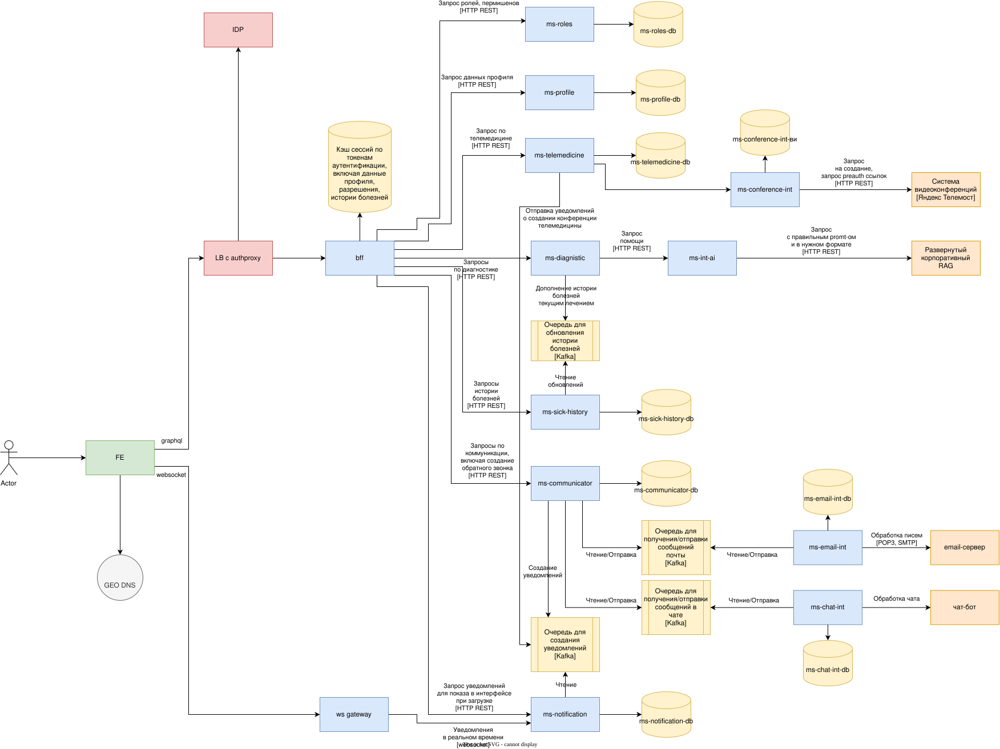

# Am.I.Sck
## Описание в оригинале
Your company wants to build a software system supporting chat nurses (advice nurse) answering questions from customers about potential health problems.

- Users: 250+ nurses worldwide, hundreds to thousands of customers
- Requirements:
  - access patient medical histories
  - provide an service-level agreement on turnaround time for interaction
  - assist nurses in providing medical diagnosis
  - support nurses geographically divergent from clients
  - enable client customers to reach local medical staff (if necessary), contacting the local medical staff directly ahead of time (if necessary)
  - eventually enable parts of the system for direct client customer use
- Additional Context:
  - company is building software solutions in niche spaces like this one
  - agressive growth with 2nd round VC funding
  - fast time to market is overall company goal to capture market
  - our lawyers have determined that the conversation is not considered a medical record

## На русском
Вот перевод:

- Пользователи: 250+ медсестёр по всему миру, от сотен до тысяч клиентов
- Требования:
    - доступ к историям болезни пациентов
    - предоставление соглашения об уровне обслуживания (SLA) по времени отклика при взаимодействии
    - помощь медсёстрам в постановке медицинского диагноза
    - поддержка медсестёр, географически удалённых от клиентов
    - предоставление клиентам-заказчикам возможности связаться с местным медицинским персоналом (при необходимости), с заблаговременным прямым обращением к местному медицинскому персоналу (при необходимости)
    - в перспективе — открытие частей системы для прямого использования клиентами-заказчиками
- Дополнительный контекст:
    - компания создаёт программные решения в нишевых областях, подобных этой
    - агрессивный рост при финансировании второго раунда от венчурных капиталистов
    - быстрый выход на рынок — общая цель компании для захвата рынка
    - наши юристы установили, что данный разговор не считается медицинской записью

## Участники
- медсестры (250+)
- клиенты (100-9000)

## События
- сохранение данных о болезни и лечении клиента. участники: медсестра
- получение истории болезни пациента. участники: клиент, медсесетра
- запрос помощи при постановке диагноза. участники: медсесетра, подключенный через API внутренний ai
- общение в формате телемедицины. участники: медсесетра, клиент
- связь через чат, email, обратный звонок с ближайшим мед.персоналом. участники: клиент, медсестра

### Операции
- CRUD истории болезней. доступ ролям: медсестра
- Доступ на чтение истории болезни. доступ по ролям: клиент
- Запрос помощи при постановке диагноза. участники: медсесетра
- Запрос на создание видеоконференции для сессии телемедицины. доступ по ролям: медсестра
- Подключение к видеоконференции для сессии телемедицины. доступ по ролям: медсестра, клиент
- Отправка вопроса через внутренний чат, email с ближайшим медработником. доступ по ролям: клиент
- Запрос обратного звонка. доступ по ролям: клиент
- Доступ к внетреннему чату, интерфейсу для почты. доступ по ролям: медсестра
- Получение уведомления о запросе на обратный звонок. доступ по ролям: медсестра

### Агрегаты
- История болезней
- Диагностика
- Телемедицина
- Коммуникатор с клиентом
- Уведомления

### Компоненты
- `IDP` - аутентификация пользователей, выдача токена авторизации
- `ms-roles` - сервис по управлению ролями пользователей
- `grafana` - сервис мониторинга состояния системы
- `logstash` - сервис-агрегатор логов системы
- `ms-profile` - сервис профилей клиентов, медсестер
- `ms-int-ai` - сервис для интеграции с развернутым внутри контура LLM, RAG
- `ms-notification` - сервис уведомлений пользователей.
  - медсестры уведомляются о событиях в чате, почте, заказе обратного звонка, назначении конференции телемедицины
  - клиенты уведомляются о событиях в чате, назначении конференции телемедицины
- `ms-chat-int` - интеграционный сервис, реализующий простой чат
- `ms-email-int` - интеграционный сервис, реализующий простейший обработчик email. получение письем, отправка ответа
- `ms-communicator` - бизнес-сервис, реализующий логику работы коммуникации с клиентом
- `ms-telemedicine` - бизнес-сервис, реализующий логику телемидицины
- `ms-conference-int` - интеграционный сервис для взаимодействия с платформой конференций. создание комнат, подключение, запрос ссылок
- `ms-sick-history` - сервис для работы с историями болезней
- `ms-diagnistic` - сервис для диагностики текущего клиента

#### На что обратить внимание?
- При работе с AI нужно подтверждение медсестрой
- Медданные храняться в зашифрованном виде
- Для работы с брокером сообщений предусматриваем DLQ

